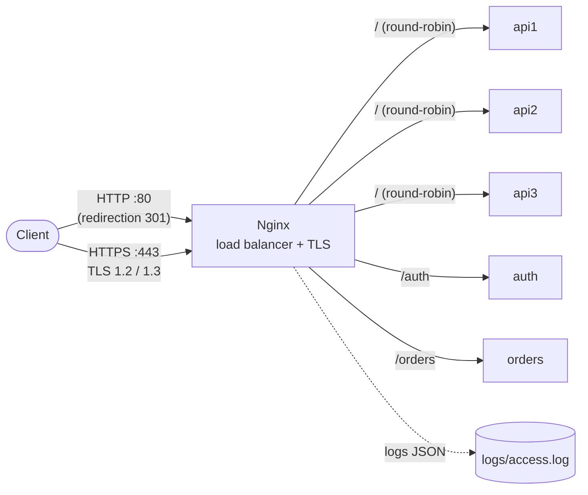

# microservices-ha-cluster

> **EN —** A highly available microservices architecture: 3 FastAPI replicas behind an Nginx HTTPS load balancer that keeps serving when a server goes down.
> Includes fault-tolerance demo scripts and a Kubernetes (kind) version with self-healing pods.


## 1. Objectif

Montrer, sur un poste local, une architecture **haute disponibilité** : un load balancer Nginx en **HTTPS** répartit le trafic entre 3 réplicas d'une API.
Quand un réplica tombe, le service continue de répondre sans erreur côté client.
Une version **Kubernetes** montre la même idée avec l'auto-réparation des pods.

## 2. Architecture



Chaque réplica de l'API renvoie **son nom de conteneur**, ce qui rend la répartition visible.

## 3. Technologies et pourquoi

| Technologie | Rôle | Pourquoi ce choix |
|---|---|---|
| **Python 3.12 + FastAPI** | Microservices | Léger, rapide à écrire, `/health` en quelques lignes |
| **Docker** | Conteneurisation | Même environnement partout, images slim et utilisateur non-root |
| **Docker Compose** | Orchestration locale | Lance toute la stack avec une seule commande |
| **Nginx 1.27** | Load balancer, reverse proxy, TLS | Standard de l'industrie, round-robin et détection de pannes natifs |
| **OpenSSL** | Certificat TLS | Génère un certificat auto-signé local, sans secret dans Git |
| **Kubernetes (kind)** | Orchestration (bonus) | Montre les probes, le Service, l'Ingress et l'auto-réparation |
| **Make** | Raccourcis | `make up`, `make test`… faciles à retenir |

## 4. Prérequis

- Docker Desktop avec intégration **WSL2** (ou Docker Engine sous Linux)
- `make`, `curl`, `openssl` (déjà présents sur Ubuntu)
- Bonus Kubernetes : [`kind`](https://kind.sigs.k8s.io/) v0.25.0 et `kubectl` v1.31

## 5. Lancement en 3 commandes

```bash
git clone https://github.com/<TON_USER>/microservices-ha-cluster.git
cd microservices-ha-cluster
make up        # génère le certificat, construit les images et lance tout
```

Puis ouvrir **https://localhost** (accepter l'avertissement du certificat auto-signé).

| Commande | Effet |
|---|---|
| `make up` | Lance la stack |
| `make down` | Arrête la stack |
| `make test` | Démontre le round-robin |
| `make failover` | Démontre la tolérance aux pannes |
| `make logs` | Affiche les logs JSON de Nginx |

## 6. Démonstration

### Load balancing (round-robin)

```bash
make test
```
Les 9 requêtes sont servies tour à tour par `api1`, `api2`, `api3`.


### Panne d'un serveur

```bash
make failover
```
Le script arrête `api2` en pleine charge : Nginx l'écarte (`max_fails` / `fail_timeout`) et renvoie la requête vers un autre réplica (`proxy_next_upstream`). Résultat attendu : **30/30 requêtes réussies**, puis `api2` est redémarré.


### HTTPS

```bash
curl -I http://localhost            # 301 vers https
curl -kI https://localhost          # en-têtes HSTS et X-Content-Type-Options
curl -k --tls-max 1.1 https://localhost   # refusé : seuls TLS 1.2 et 1.3 sont acceptés
```


### Bonus : Kubernetes (auto-réparation)

```bash
kind create cluster --config k8s/kind-config.yaml
for s in api auth orders; do kind load docker-image microservices-ha-cluster/$s:1.0.0 --name ha-cluster; done
kubectl apply -f https://raw.githubusercontent.com/kubernetes/ingress-nginx/controller-v1.11.3/deploy/static/provider/kind/deploy.yaml
kubectl wait -n ingress-nginx --for=condition=ready pod -l app.kubernetes.io/component=controller --timeout=180s
kubectl apply -f k8s/api.yaml -f k8s/auth.yaml -f k8s/orders.yaml -f k8s/ingress.yaml
./scripts/k8s-selfheal.sh      # supprime un pod : Kubernetes le recrée
```
L'Ingress répond sur **http://localhost:8080**. Suppression : `kind delete cluster --name ha-cluster`.


## 7. Structure

```
services/{api,auth,orders}/   Code FastAPI + Dockerfile de chaque service
nginx/nginx.conf              Load balancer, TLS, logs JSON
scripts/                      Certificat TLS et scripts de démonstration
k8s/                          Manifests Kubernetes (kind)
docs/EXPLICATIONS.md          Concepts et questions d'entretien
```

## 8. Ce que j'ai appris

- Configurer un **load balancer** Nginx : upstream, round-robin, détection de serveur défaillant et nouvel essai transparent.
- Mettre en place **TLS** : certificat, SAN, versions de protocole, redirection HTTP → HTTPS, HSTS.
- Écrire des **Dockerfiles** sûrs et légers (image slim, non-root, `HEALTHCHECK`) et orchestrer avec Compose (`depends_on` sur l'état de santé).
- Produire des **logs structurés JSON** exploitables par une stack ELK.
- Retrouver les mêmes concepts dans **Kubernetes** : Deployment, probes, Service, Ingress, auto-réparation.

## 9. Améliorations possibles (en production)

- Certificat signé par une vraie autorité (**Let's Encrypt** avec renouvellement automatique).
- Supprimer le point unique de défaillance du load balancer : 2 Nginx avec **Keepalived** (IP virtuelle) ou load balancer cloud.
- Health checks actifs sur Nginx, ou passage à **HAProxy / Traefik**.
- Vraie base de données et authentification réelle (JWT, secrets dans un coffre type **Vault**).
- **Monitoring** (Prometheus + Grafana) et centralisation des logs (ELK).
- **CI/CD** (GitHub Actions) : tests, scan des images (Trivy), déploiement.
- Kubernetes : HorizontalPodAutoscaler, cluster multi-nœuds, NetworkPolicies.

## Licence

[MIT](LICENSE) — Taje Dine Sidi Mohamed
